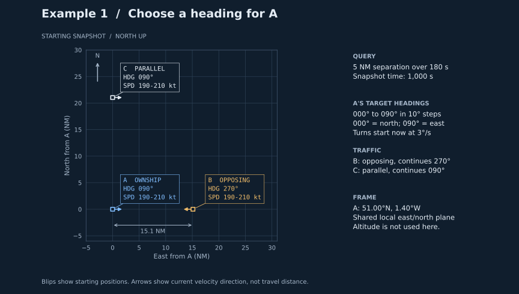
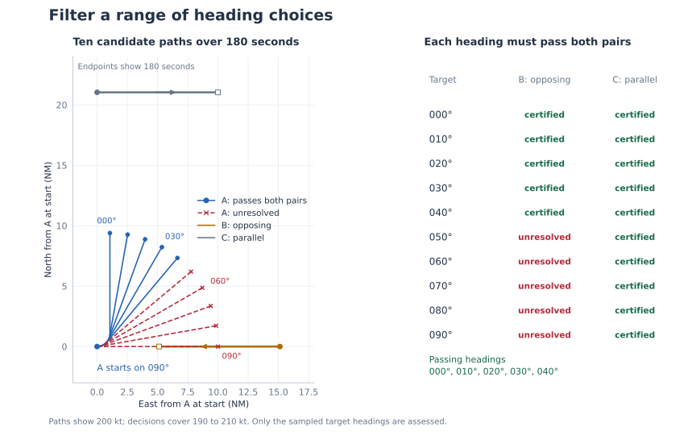
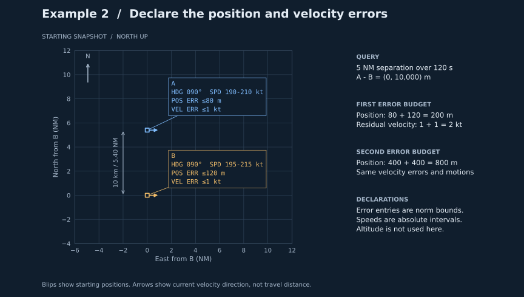
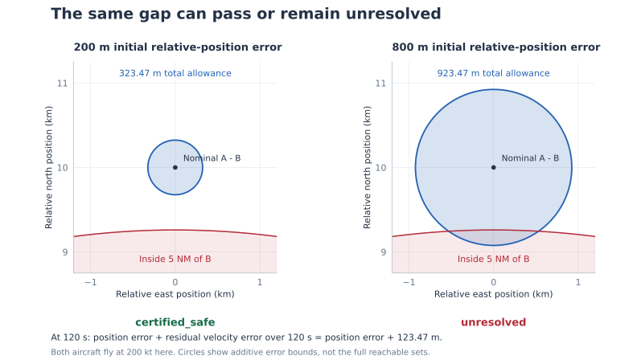
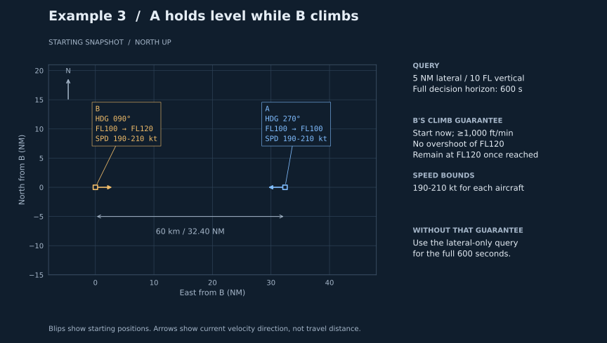
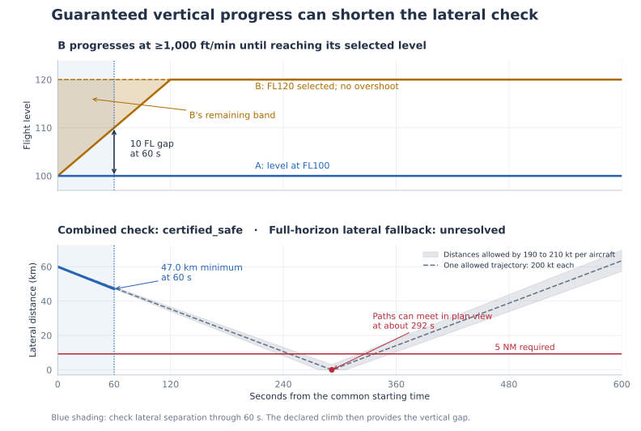

# Using separation checks in an application

Use a separation check to decide whether a pair needs further conflict checking, or whether a candidate heading passes your application's separation requirement. These three examples cover heading choices, uncertainty bounds and a climb. Their aircraft and bounds are illustrative; choose values that cover your application's motion and errors.

## Run the examples

With Python 3.13, open a terminal in this repository's top-level folder—the one containing `pyproject.toml`—and run:

```bash
uv sync
uv run python -m examples.heading_filter
uv run python -m examples.uncertainty_bounds
uv run python -m examples.vertical_progress
```

To use the library in your own project, follow the [installation instructions](../README.md#installation). Each example below is self-contained; run its code blocks in order.

## 1. Check candidate headings against traffic

A is heading east towards opposing traffic B, with another aircraft C farther north. We will test target headings from 000° to 090° in 10° steps over the next 180 seconds. These are compass headings: 000° points north and 090° keeps A heading east. Each pair must remain at least 5 NM apart.



In this [heading-filter example](../examples/heading_filter.py), all positions refer to the same snapshot time of 1,000 s. Declare A's current motion and the two traffic aircraft:

```python
from dataclasses import replace

from geometric_safety import HeadingMotion, certify_heading_separation_from_latlon
from geometric_safety.util import KT_TO_MPS

a = HeadingMotion(
    heading0_deg=90.0,
    target_heading_deg=90.0,
    turn_rate_deg_s=3.0,
    speed_min_mps=190.0 * KT_TO_MPS,
    speed_max_mps=210.0 * KT_TO_MPS,
)
traffic = {
    # Each entry contains latitude, longitude and declared motion.
    "opposing": (51.0, -1.0, replace(a, heading0_deg=270.0, target_heading_deg=270.0)),
    "parallel": (51.35, -1.40, a),
}
```

For each target, change only `target_heading_deg`, preserving A's current eastbound heading. Check every pair and keep the heading only if all results are `certified_safe`:

```python
accepted: list[int] = []
for heading in range(0, 91, 10):
    candidate = replace(a, target_heading_deg=heading)
    pair_results = {
        identifier: certify_heading_separation_from_latlon(
            a=candidate,
            b=motion,
            a_lat=51.0,
            a_lon=-1.40,
            b_lat=latitude,
            b_lon=longitude,
            separation_threshold_m=5.0 * 1852.0,
            horizon_s=180.0,
        )
        for identifier, (latitude, longitude, motion) in traffic.items()
    }
    if pair_results and all(result.status == "certified_safe" for result in pair_results.values()):
        accepted.append(heading)

    statuses = ", ".join(f"{name}={result.status}" for name, result in pair_results.items())
    print(f"{heading:03.0f}°: {statuses}")

print("Passing headings:", ", ".join(f"{heading:03.0f}°" for heading in accepted))
```

Each query includes the turn and subsequent straight flight, with speed allowed to vary between 190 and 210 knots throughout. The nonempty `pair_results` check prevents an empty traffic list from being mistaken for a completed assessment.

```text
000°: opposing=certified_safe, parallel=certified_safe
010°: opposing=certified_safe, parallel=certified_safe
020°: opposing=certified_safe, parallel=certified_safe
030°: opposing=certified_safe, parallel=certified_safe
040°: opposing=certified_safe, parallel=certified_safe
050°: opposing=unresolved, parallel=certified_safe
060°: opposing=unresolved, parallel=certified_safe
070°: opposing=unresolved, parallel=certified_safe
080°: opposing=unresolved, parallel=certified_safe
090°: opposing=unresolved, parallel=certified_safe
Passing headings: 000°, 010°, 020°, 030°, 040°
```



Five of the ten sampled headings pass both checks. The others remain unresolved against B. The plotted paths use a constant 200 knots for illustration; the decisions cover the full declared speed bounds.

Supply all relevant traffic, and check each candidate you intend to offer. Testing a few headings does not certify the headings between them. Other application constraints still apply.

### Use the result

| Outcome | What to do |
| --- | --- |
| `certified_safe` | The pair passes for the supplied motion, bounds and horizon. |
| `unresolved` | Keep the pair for further checking, or withhold the candidate. This does not prove a conflict. |
| `unsupported` | Use a method covering that motion; `reason` explains what is unsupported. |
| `ValueError` | Correct the invalid input, such as reversed speed bounds or a negative horizon. |

Check `result.status`, rather than `if result`. For a stored conflict, `certified_safe` lets you exclude that pair for the declared query. For a heading filter, every required pair must pass. Optional distance and time fields are [diagnostics](motion-models.md#diagnostics), not a conflict-free interval you can skip.

## 2. Include position and velocity errors

A is 10 km north of B, and both travel east. We require 5 NM separation for 120 seconds. Their speed intervals overlap, but their position estimates and residual velocities also have bounded errors.



The [uncertainty example](../examples/uncertainty_bounds.py) uses the Cartesian interface. Declare the two speed intervals:

```python
from dataclasses import replace

from geometric_safety import HeadingMotion, certify_heading_separation
from geometric_safety.util import KT_TO_MPS

a = HeadingMotion(
    heading0_deg=90.0,
    target_heading_deg=90.0,
    turn_rate_deg_s=0.0,
    speed_min_mps=190.0 * KT_TO_MPS,
    speed_max_mps=210.0 * KT_TO_MPS,
)
b = replace(a, speed_min_mps=195.0 * KT_TO_MPS, speed_max_mps=215.0 * KT_TO_MPS)
```

Add the per-aircraft bounds to obtain relative bounds: `80 + 120 = 200 m` for position and `1 + 1 = 2 knots` for residual velocity. Compare that position budget with a wider allowance of 400 m per aircraft:

```python
position_budgets_m = {
    "bounded_errors": 80.0 + 120.0,
    "wider_position_bounds": 400.0 + 400.0,
}
relative_velocity_error_mps = (1.0 + 1.0) * KT_TO_MPS

for name, position_bound_m in position_budgets_m.items():
    result = certify_heading_separation(
        relative_position_m=(0.0, 10000.0),  # Position of A minus B: east, north.
        a=a,
        b=b,
        separation_threshold_m=5.0 * 1852.0,
        horizon_s=120.0,
        relative_position_error_m=position_bound_m,
        relative_velocity_error_mps=relative_velocity_error_mps,
    )
    print(f"{name}: {result.status}, inflation={result.inflation_m:.2f} m")
```

These are bounds on error magnitude, additional to the speed intervals. Position-error bounds apply at the start; residual-velocity bounds apply at every instant. A standard deviation or an observed average is not such a bound. Over 120 seconds, the smaller error allowance is `200 + relative_velocity_error_mps * 120`, or 323.47 m:

```text
bounded_errors: certified_safe, inflation=323.47 m
wider_position_bounds: unresolved, inflation=923.47 m
```



The positions and motions have not changed; the larger error budget prevents acceptance. The circles illustrate the additive errors at 120 seconds with both aircraft flying at 200 knots. The solver also covers their different speed intervals over the whole horizon. See [deviation bounds](motion-models.md#deviation-bounds) for other error allowances.

## 3. Shorten the lateral check when vertical progress is guaranteed

Two aircraft start 60 km apart, closing head-on at FL100. A stays level while B is instructed to FL120. The full horizon is 600 seconds, with requirements of 5 NM laterally or 10 FL vertically; 10 FL is 1,000 feet.



If B climbs from the start at 1,000 ft/min or more, does not overshoot FL120 and remains there on arrival, the vertical gap is sufficient after 60 seconds. The combined function checks lateral separation up to that time. The horizontal speed bounds must cover the climb too.

For this [vertical-progress example](../examples/vertical_progress.py), declare the opposing motions and A's position relative to B:

```python
from dataclasses import replace

from geometric_safety import (
    HeadingMotion,
    certify_heading_separation,
    certify_heading_separation_with_vertical,
)
from geometric_safety.util import KT_TO_MPS

a = HeadingMotion(
    heading0_deg=270.0,
    target_heading_deg=270.0,
    turn_rate_deg_s=0.0,
    speed_min_mps=190.0 * KT_TO_MPS,
    speed_max_mps=210.0 * KT_TO_MPS,
)
b = replace(a, heading0_deg=90.0, target_heading_deg=90.0)
relative_position_m = (60000.0, 0.0)
horizon_s = 600.0
```

With the minimum progress established, pass the full requested horizon to the combined function. It calculates the shorter lateral horizon:

```python
combined = certify_heading_separation_with_vertical(
    relative_position_m=relative_position_m,
    a=a,
    b=b,
    a_current_fl=100.0,
    a_selected_fl=100.0,
    b_current_fl=100.0,
    b_selected_fl=120.0,
    minimum_vertical_rate_fpm=1000.0,
    separation_threshold_m=5.0 * 1852.0,
    horizon_s=horizon_s,
    required_vertical_gap_fl=10.0,
)
print(f"guaranteed_progress: {combined.status}, lateral horizon={combined.lateral_horizon_s:.0f} s")
```

If the minimum progress cannot be guaranteed, use the lateral-only function for the full horizon instead:

```python
lateral_only = certify_heading_separation(
    relative_position_m=relative_position_m,
    a=a,
    b=b,
    separation_threshold_m=5.0 * 1852.0,
    horizon_s=horizon_s,
)
print(f"no_progress_guarantee: {lateral_only.status}, lateral horizon={horizon_s:.0f} s")
```

```text
guaranteed_progress: certified_safe, lateral horizon=60 s
no_progress_guarantee: unresolved, lateral horizon=600 s
```



The shortened check passes. When the illustrated paths at 200 knots each meet in plan view at about 292 seconds, B is already at FL120 and A remains at FL100. Without the climb guarantee, the full lateral check cannot pass.

Use the lateral-only call if the climb may start late, pause or reverse. A selected level or an eventual climb rate is not enough. Pass flight levels directly, including fractional values; the combined interface has no allowance for altitude measurement error. See [vertical filtering](motion-models.md#vertical-filtering) for its full assumptions and rounding rules.

## Apply the examples to your own data

- Align positions and velocity directions to one starting time. Account for uncertainty introduced when aligning older observations.
- Set speed bounds for the entire decision horizon, including turns and climbs. Use `KT_TO_MPS` to convert knots; distances are in metres and durations in seconds.
- Choose a horizon that covers the decision. The model follows one immediate, fixed-rate shortest turn and then straight flight; it does not follow later route turns. Reassess when instructions, bounds or starting states change.
- For latitude/longitude inputs, check the local-plane approximation and its required error allowances for your operating region. See [coordinate frames](motion-models.md#coordinate-frames).

The [model reference](motion-models.md) gives the supported motions, diagnostic meanings and numerical limits behind an acceptance. For a latency-sensitive application, warm up representative calls first: the first call can compile code. See [timing and benchmarks](../paper/validation.md).
